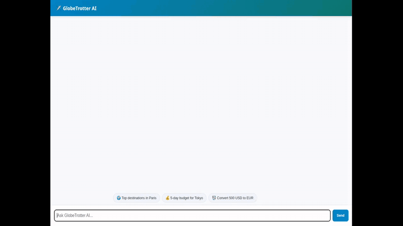

# GlobeTrotter AI — Personal Travel Concierge Agent

GlobeTrotter AI is an agentic AI travel and local concierge application built with Google's Agent Development Kit (ADK) and Gemini models. It assists travelers by discovering destinations, building trip budget breakdowns, generating scenic destination media, converting currencies, and personalizing responses using long-term cross-session memory.



---

## Capabilities & Architecture

GlobeTrotter AI is powered by the following wired Google Cloud services and ADK features:

### 1. Long-Term Cross-Session Memory
- **Vertex AI Memory Bank**: Integrated via `PreloadMemoryTool` and memory generation callbacks. Automatically persists traveler facts and preferences (home airport, budget tier, dietary preferences, favorite activities) across independent chat sessions.

### 2. Database & Asset Storage
- **Google Cloud Firestore**: Persists destination records, attractions, and local travel guides (`search_destinations`, `add_destination`).
- **Google Cloud Storage (GCS)**: Public storage bucket hosting AI-generated destination images and video previews with public HTTPS links.

### 3. Generative Media Tools
- **Destination Image Generation**: Uses `gemini-3.1-flash-lite-image` in the `global` region to generate high-quality destination artwork (`generate_destination_image`), saving session artifacts and uploading directly to GCS.
- **Destination Video Generation**: Uses Google's Omni model (`gemini-omni-flash-preview`) in the `global` region to generate 3-second preview videos (`generate_destination_video`), saving session artifacts and returning GCS public URLs.

### 4. Code Sandbox & Function Tools
- **Trip Budget Calculation**: Executes Python code inside the ADK Code Sandbox (`calculate_trip_budget`) to compute daily expense breakdowns, flight totals, and a 10% contingency buffer.
- **Currency Exchange Rate Tool**: Real-time currency conversions via Open Exchange Rates API (`get_currency_exchange_rate`).
- **Weather & Time Tools**: Fetches current destination weather (`get_weather`) and local timezone clock (`get_current_time`).

### 5. Rich UI Rendering (A2UI)
- **A2UI Display Cards**: Generates structured A2UI display cards (Card, Column, Row, Text, Image) via `A2uiSchemaManager` (v0.8) rendered natively in both ADK Web and the custom chat UI.

### 6. Full-Stack Web Frontend
- **FastAPI A2A Proxy**: Lightweight Python backend forwarding browser chat requests to the reasoning engine over the A2A protocol.
- **Custom Chat Interface**: Modern UI featuring ocean accent styling, prompt suggestion chips, and live Markdown parsing (`marked.js`).

---

## Planned / Stretch Capabilities
- **Cloud Trace**: Distributed tracing for multi-step itinerary reasoning (*planned, not yet implemented*).

---

## Local Setup & Development

### Prerequisites
- Python 3.11+
- `uv` package manager (`pip install uv`) or `agents-cli`

### Installation & Setup

1. **Clone the repository and install dependencies**:
   ```bash
   git clone <repository-url>
   cd globetrotter-agent
   uv sync
   ```

2. **Set Up Environment Variables**:
   ```bash
   export PROJECT_ID="<your-gcp-project-id>"
   export AGENT_ENGINE_RESOURCE_NAME="projects/<project-id>/locations/<region>/reasoningEngines/<id>"
   export AGENT_DIRECTORY="app"
   ```

3. **Run Local ADK Playground**:
   ```bash
   uv run adk web . --port 8080 --reload_agents
   ```

4. **Run the Custom Frontend Server**:
   ```bash
   cd frontend
   pip install -r requirements.txt
   python main.py
   ```
